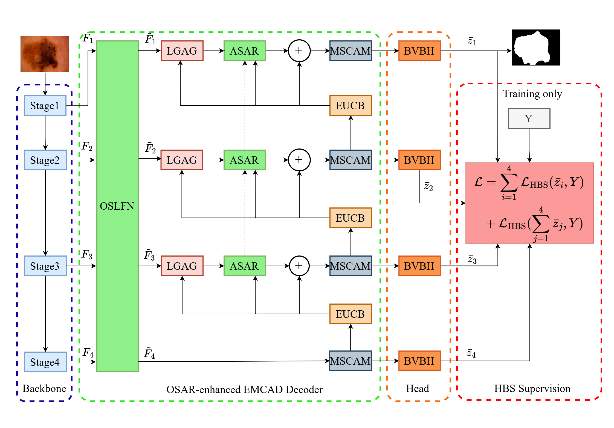

# GeoTraceNet: Geometry-Guided Scale-Evolution Network

This repository is the reproducibility release for **GeoTraceNet**, an EMCAD-based
network for binary skin-lesion segmentation on **ISIC2018 Task 1**. The release
contains the runnable implementation, the paper configuration, and the checksum
manifest for the best checkpoints from the three reported seeds `{0, 1, 2}`.
The large trained checkpoints are distributed as a separate archive.

The current reproducibility release is `v0.1.0`. The release tag identifies the
exact code and configuration version associated with the reported experiments.



*Overall architecture. The four-scale PVTv2-B2 features are organized by the
OSAR neck, decoded by EMCAD with ASAR refinement, converted to stage-wise
predictions by BVBH, and supervised during training by HBS.*

## What the method does

GeoTraceNet coordinates three parts of the segmentation pipeline:

| Component | Role |
| --- | --- |
| **OSLFN** | Treats the four encoder scales as an ordered path and uses first- and second-order path signatures to model directed scale evolution. A bounded Lie action writes the resulting correction back to each feature map. |
| **ASAR** | Compares the ordinary adjacent-skip route with a controlled reference route and applies a bounded correction before decoder fusion, reducing shallow artifact propagation. |
| **BVBH** | Produces structured stage-wise logits using matrix-field compatibility and valid-grid two-tail trimming for robust local prediction. |
| **HBS** | Uses one binary mask to construct five morphological zones and supervises radial confidence ranking together with boundary-normal alignment. |

The model uses a PVTv2-B2 encoder, the EMCAD cascaded decoder, four deep-supervised
prediction stages, and a single forward pass at inference time.

## Reported ISIC2018 result

The following values are obtained by evaluating the three trained checkpoints
with `run.py eval` on the ISIC2018 test split. The checkpoint files are supplied
in the separate `GeoTraceNet_checkpoints.zip` archive because each file is
larger than GitHub's normal single-file limit.

| Checkpoint | Seed | Dice | IoU |
| --- | ---: | ---: | ---: |
| `GeoScaleSignature_927_seed0-best.pth` | 0 | 0.914826 | 0.855833 |
| `GeoScaleSignature_927_seed1-best.pth` | 1 | 0.911559 | 0.850851 |
| `GeoScaleSignature_927_seed2-best.pth` | 2 | 0.910686 | 0.848671 |
| **Mean ± sample std.** | `{0,1,2}` | **0.912357 ± 0.002182** | **0.851785 ± 0.003671** |

The manuscript reports the rounded values `0.9124 ± 0.0022` Dice and
`0.8518 ± 0.0037` IoU, together with its HD95 evaluation.

## Repository layout

| Path | Description |
| --- | --- |
| `run.py` | Unified training, evaluation, smoke-test, and data-preparation entry point. |
| `configs/927_isic2018.yaml` | Paper configuration for the 927 model. |
| `emcad/` | Registry, model assembly, training engine, evaluation, and reporting. |
| `emcad/modules/` | OSLFN, ASAR-compatible decoder, BVBH, HBS loss, and supporting modules. |
| `lib/` | EMCAD decoder and PVTv2-B2 implementation. |
| `geo_utils/` | ISIC2018 loading and preparation utilities. |
| `checkpoints/` | Destination for the separately downloaded reported checkpoints. |
| `assets/model_architecture.png` | Main architecture figure used in the paper. |
| `CHECKPOINTS_SHA256SUMS.txt` | SHA-256 checksums for the separately downloaded checkpoints. |

## Trained checkpoint download

The three trained checkpoints are distributed separately in
`GeoTraceNet_checkpoints.zip`.

- [Download the checkpoints from Baidu Netdisk](https://pan.baidu.com/s/1WrdGMSM2Dxu2MDwcxkSN3A?pwd=6666)
- Extraction code: `6666`

## Quick start

Run all commands from the extracted `GeoTraceNet/` directory.

### 1. Install dependencies

Use Python 3.10 or 3.11 with a CUDA-enabled PyTorch installation. The pinned
versions are listed in `requirements.txt`.

```bash
python -m venv .venv
source .venv/bin/activate
python -m pip install --upgrade pip
python -m pip install -r requirements.txt
```

### 2. Provide the trained checkpoints, encoder weights, and dataset

The code archive does not contain the large trained checkpoint files. Download
`GeoTraceNet_checkpoints.zip` from the download link above, extract it, and
copy its `checkpoints/` directory into this repository. Verify the files with:

```bash
sha256sum -c CHECKPOINTS_SHA256SUMS.txt
```

The separate PVTv2-B2 initialization weights are not redistributed here. Obtain
the upstream weight file and place it at:

```text
pretrained_pth/pvt/pvt_v2_b2.pth
```

The official ISIC2018 Task 1 data are also not redistributed. Arrange the
dataset as follows, or pass another location through
`--override dataset.data_root=/path/to/ISIC2018`:

```text
data/ISIC2018/
  train/images  train/masks
  valid/images  valid/masks
  test/images   test/masks
```

### 3. Evaluate a downloaded checkpoint

```bash
python run.py eval \
  --config configs/927_isic2018.yaml \
  --checkpoint checkpoints/GeoScaleSignature_927_seed0-best.pth \
  --split test \
  --override dataset.data_root=/path/to/ISIC2018
```

To evaluate all three reported seeds:

```bash
for seed in 0 1 2; do
  python run.py eval \
    --config configs/927_isic2018.yaml \
    --checkpoint checkpoints/GeoScaleSignature_927_seed${seed}-best.pth \
    --split test \
    --override dataset.data_root=/path/to/ISIC2018
done
```

Results are written below `outputs/` by default.

### 4. Train from the PVTv2-B2 initialization

The paper protocol uses exactly the three seeds `{0, 1, 2}`:

```bash
python run.py train \
  --config configs/927_isic2018.yaml \
  --override dataset.data_root=/path/to/ISIC2018 \
  --override train.seed_list='[0, 1, 2]'
```

This command starts new runs from the PVTv2-B2 initialization. It does not
resume from the separately downloaded trained checkpoints.

### 5. Run a small sanity check

```bash
python run.py smoke \
  --config configs/927_isic2018.yaml \
  --override dataset.data_root=/path/to/ISIC2018
```

The smoke test checks model construction and one short training path; it is not
a performance evaluation.

## Reproducibility settings

The paper configuration fixes the following main settings:

| Setting | Value |
| --- | --- |
| Dataset | ISIC2018 Task 1, binary segmentation |
| Input resolution | `352 × 352` |
| Batch size | `32` |
| Optimizer | AdamW, learning rate `1e-4`, weight decay `1e-4` |
| Training seeds | `{0, 1, 2}` |
| Multi-scale rates | `{0.75, 1.0, 1.25}` |
| Augmentation library | Albumentations `2.0.8` |
| Training schedule | 100 epochs with validation-based early stopping |
| Evaluation | AMP-enabled, deterministic seed handling |

Use the same dataset split and record the installed package versions when
comparing results.

## License and release notes

Original code in this release is distributed under the MIT License in `LICENSE`.
Adapted third-party components and external assets remain subject to their
upstream terms; see `THIRD_PARTY_NOTICES.md`.

Each checkpoint is about 103 MiB, which is larger than GitHub's normal 100 MiB
single-file limit. The public code ZIP therefore excludes the checkpoints.
Publish `GeoTraceNet_checkpoints.zip` through the external weights host (or
as GitHub Release assets) and place the resulting link in this section. Avoid
committing the 287 MiB combined archive into ordinary Git history. The included
`.gitattributes` file configures Git LFS if the checkpoints are later tracked
directly in a Git repository.

## Citation

If you use this code or the released checkpoints, cite the accompanying
GeoTraceNet manuscript:

```bibtex
@misc{zhang2026geotracenet,
  title   = {GeoTraceNet: A Geometry-Guided Scale-Evolution Network for Robust Skin-Lesion Segmentation},
  author  = {Zhang, Lingyun and Wei, Xin and Zhang, Jian and Cao, Junyang and Huang, Jinbo},
  year    = {2026},
  version = {v0.1.0},
  url     = {https://github.com/zzzlyly/GeoTraceNet},
  note    = {Reproducibility release; manuscript prepared for submission to Knowledge-Based Systems},
}
```

The formal journal citation and DOI will be added after publication. The
machine-readable citation metadata is also provided in `CITATION.cff`.
